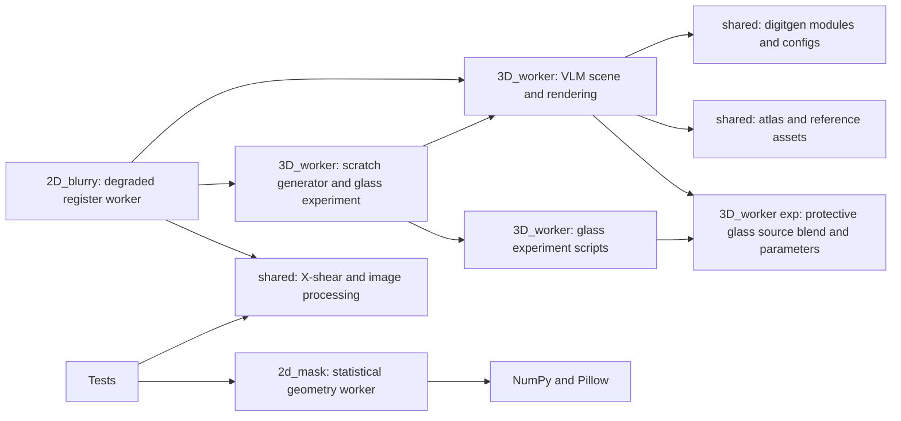

# Repository dependency graph and reorganization

This graph was recorded before moving files. Static imports and the original output inventory are in `dependency_inventory_before.json`; dynamic and data dependencies were checked separately.

The worker called `2D_blurry` is still a Blender 3D pipeline: the name describes its low-resolution visual appearance. `2d_mask` is the standalone statistical geometry and conditioning-image worker, not a revival of the removed 2.5D renderer. The atlas and digitgen modules are shared, not duplicated. Experiment datasets and intermediate source scene files remain separate and are not deleted. Links preserve runtime paths used by older scripts and archives; links are not duplicate files. Historical experiment snapshot scripts and metadata contain recorded original paths and are preserved as historical records.

## Current layout

- `2D_blurry/`: degraded register worker; its three existing degraded review batches are in `2D_blurry/exp/`.
- `3D_worker/`: 3D worker and review code; prior 3D, material, and diffusion experiments are in `3D_worker/exp/`. The protective glass `.blend` here remains a live worker dependency.
- `2d_mask/`: independent `geometry_worker` source; statistical geometry and prompt-box comparisons are in `2d_mask/exp/`.
- `shared/`: single copies of atlas/reference assets, configs and shared `digitgen` code.

Root directory links and worker-local links preserve runtime data paths. Entry-point Python scripts moved; use the worker README commands rather than historical root-level commands. Experiment metadata and documentation record historical paths without being rewritten.

## Validation

All 2,049 inventoried pre-move files were checksum verified at their compatibility paths. No broken symlinks were found. A Blender render from each relocated Blender entry point and a two-image 2D geometry generation/audit succeeded; 14 focused unit tests passed. The broader historical suite had 34 passes and six errors due to Barlow fonts already missing before this reorganization; their absence is documented in the 2026-11-01 atlas cleanup report. The current photo-atlas workers render successfully without those legacy fonts. Detailed machine-readable results: `validation.json`.
